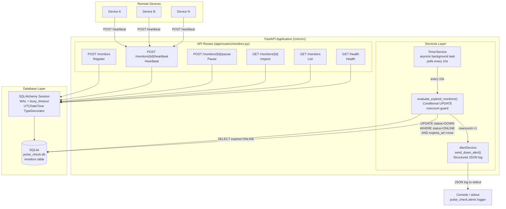
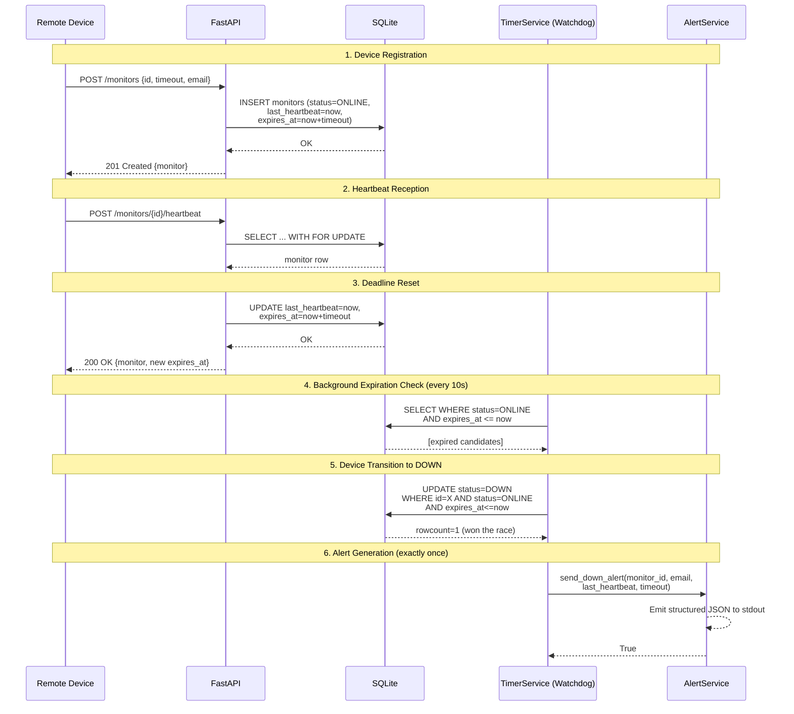
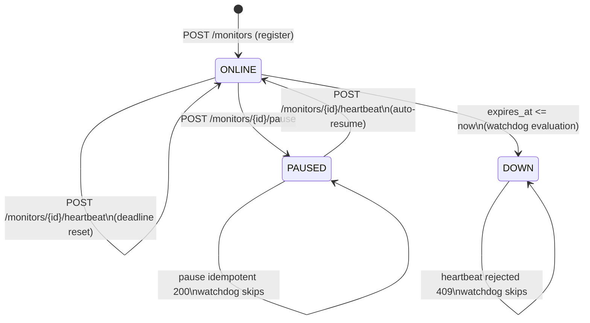

# Pulse-Check API — Watchdog Sentinel

> **CritMon Servers Inc.** | Production-minded Dead Man's Switch monitoring API

---

## A. Project Introduction

### Project Name
**Pulse-Check API (Watchdog Sentinel)**

### Description
Pulse-Check API is a backend web service that monitors remote devices through periodic heartbeat requests. It acts as a **Dead Man's Switch**: if a device stops sending heartbeats before its configured deadline expires, the system automatically declares it `DOWN` and raises a structured alert — without any manual intervention.

### Business Problem
In distributed infrastructure, remote devices (servers, IoT sensors, edge nodes, scheduled jobs) can silently fail without anyone noticing. A crashed cron job or an unreachable field sensor may go undetected for hours, causing data loss or service outages. CritMon Servers Inc. needed a lightweight, reliable service to detect these silent failures automatically.

### Solution
Pulse-Check API solves this by inverting the monitoring model: instead of the monitoring server probing devices, **each device is responsible for checking in**. If it stops checking in, the system notices. This "Dead Man's Switch" pattern is robust, simple to implement on the device side, and requires no network access from the monitoring server to the monitored device.

### Main Objectives
- Register remote devices with a configurable heartbeat timeout.
- Accept periodic heartbeat requests that reset the expiration deadline.
- Automatically detect devices that miss their deadline and mark them `DOWN`.
- Generate a structured alert immediately when a device is declared `DOWN`.
- Support pausing monitoring for planned maintenance without false alerts.
- Persist all state durably in SQLite so the system recovers correctly after restarts.

---

## B. Features

| Feature | Description |
|---|---|
| **Device Registration** | Register any remote device with a unique ID, timeout, and alert email |
| **Heartbeat Management** | Each heartbeat resets the expiration deadline; timestamps are always UTC |
| **Automatic Failure Detection** | Background watchdog polls SQLite every 10 seconds; expired `ONLINE` devices transition to `DOWN` |
| **Automatic Alert Generation** | Structured JSON alert emitted exactly once per outage, never duplicated |
| **Pause and Resume** | Pause a device for maintenance; heartbeat automatically resumes it to `ONLINE` |
| **Monitor Status Inspection** | `GET /monitors/{id}` — inspect any device's full state at any time |
| **Monitor Listing** | `GET /monitors` — paginated list with optional status filtering |
| **Health Check** | `GET /health` — reports database connectivity and watchdog status |
| **Concurrency Safety** | `SELECT ... FOR UPDATE` row-level locking + conditional UPDATE guards prevent race conditions |
| **Restart Recovery** | Stateless polling loop automatically catches monitors that expired during downtime |

---

## C. Technologies

| Technology | Version | Purpose |
|---|---|---|
| **Python** | 3.14 | Application runtime. Modern async support via `asyncio`. |
| **FastAPI** | 0.165.0 | Web framework. Provides automatic OpenAPI docs, Pydantic integration, and async lifespan management. |
| **SQLAlchemy** | 2.1.9 | ORM and database toolkit. Used for schema definition, session management, and conditional UPDATE statements. |
| **Pydantic** | 2.14.4 | Request validation and response serialization. Catches malformed input at the boundary before it reaches business logic. |
| **SQLite** | built-in | Embedded SQL database. Zero-configuration, file-based persistence. WAL mode enables concurrent reads and writes. |
| **Uvicorn** | 0.54.0 | ASGI server. Runs the FastAPI application with async support. |
| **Pytest** | 9.2.0 | Test framework. Used with fixtures, parametrize, and `TestClient` for full endpoint testing. |
| **HTTPX** | 0.28.1 | HTTP client used by FastAPI's `TestClient` for sending test requests. |

---

## D. Architecture

### Architecture Diagram



### Sequence Diagram



---

## E. Project Structure

```
pulse-check-api/
│
├── app/
│   ├── __init__.py              # Package; __version__ = "1.0.0"
│   ├── main.py                  # FastAPI app, lifespan (starts/stops TimerService)
│   ├── database.py              # Engine, WAL config, UTCDateTime TypeDecorator,
│   │                            #   get_db() dependency, init_db()
│   ├── models.py                # Monitor SQLAlchemy model + MonitorStatus enum
│   ├── schemas.py               # Pydantic v2 request/response schemas
│   ├── routers/
│   │   ├── __init__.py
│   │   └── monitors.py          # All endpoints: register, heartbeat, pause,
│   │                            #   GET by ID, GET list
│   └── services/
│       ├── __init__.py
│       ├── timer_service.py     # TimerService (async loop), evaluate_expired_monitors(),
│       │                        #   calculate_expiration()
│       └── alert_service.py     # AlertService — structured JSON console alerts
│
├── tests/
│   ├── __init__.py
│   ├── conftest.py              # Fixtures: in-memory DB, TestClient, concurrent_client
│   ├── test_monitors.py         # 20 Part 1 tests (foundation & core API)
│   ├── test_monitoring_engine.py # 24 Part 2 tests (monitoring engine & advanced)
│   └── test_part3_verification.py # 42 Part 3 tests (final verification)
│
├── docs/
│   └── api_reference.md         # Full endpoint reference with curl examples
├── requirements.txt             # Pinned production + test dependencies
├── README.md                    # This file
└── .gitignore
```

---

## F. Installation Instructions

### Requirements
- Python 3.14+
- pip (bundled with Python)

### Setup

```bash
# 1. Clone or unzip the project
cd pulse-check-api

# 2. Create a virtual environment
python -m venv venv

# 3. Activate the virtual environment

# Windows (PowerShell)
.\venv\Scripts\activate

# Linux / macOS (bash/zsh)
source venv/bin/activate

# 4. Install dependencies
pip install -r requirements.txt

# 5. Start the API server
uvicorn app.main:app --reload --host 0.0.0.0 --port 8000
```

The server starts the background watchdog automatically via the FastAPI lifespan.

| URL | Purpose |
|---|---|
| `http://localhost:8000/` | API metadata |
| `http://localhost:8000/health` | Health check + watchdog status |
| `http://localhost:8000/docs` | Interactive Swagger UI |
| `http://localhost:8000/redoc` | ReDoc documentation |
| `http://localhost:8000/openapi.json` | Raw OpenAPI schema |

---

## G. API Documentation

### `POST /monitors` — Register a Monitor

Registers a remote device for dead-man's switch monitoring. Sets initial status to `ONLINE` and calculates the first expiration deadline.

**Request body:**
```json
{
  "id": "device-123",
  "timeout": 60,
  "alert_email": "admin@critmon.com"
}
```

| Field | Type | Constraints |
|---|---|---|
| `id` | string | 1–100 chars, alphanumeric + `-_.:` |
| `timeout` | integer | 1 – 2,592,000 seconds (max 30 days) |
| `alert_email` | string | Valid email format |

**Response `201 Created`:**
```json
{
  "id": "device-123",
  "timeout": 60,
  "alert_email": "admin@critmon.com",
  "status": "ONLINE",
  "last_heartbeat": "2026-11-24T12:00:00+00:00",
  "expires_at": "2026-11-24T12:01:00+00:00",
  "created_at": "2026-11-24T12:00:00+00:00"
}
```

**Error responses:**

| Code | Reason |
|---|---|
| `409 Conflict` | Monitor ID already registered |
| `422 Unprocessable Entity` | Invalid `timeout`, `id`, or `alert_email` |

---

### `POST /monitors/{id}/heartbeat` — Send Heartbeat

Records a device check-in. Resets `last_heartbeat` and extends `expires_at` by the monitor's configured `timeout`. Automatically resumes a `PAUSED` device to `ONLINE`.

**Response `200 OK`:**
```json
{
  "message": "Heartbeat acknowledged for device 'device-123'. Expiration extended to 2026-11-24T12:02:00+00:00.",
  "monitor": {
    "id": "device-123",
    "status": "ONLINE",
    "last_heartbeat": "2026-11-24T12:01:00+00:00",
    "expires_at": "2026-11-24T12:02:00+00:00",
    "timeout": 60,
    "alert_email": "admin@critmon.com",
    "created_at": "2026-11-24T12:00:00+00:00"
  }
}
```

**Error responses:**

| Code | Reason |
|---|---|
| `404 Not Found` | Monitor ID does not exist |
| `409 Conflict` | Monitor is `DOWN` — cannot revive via heartbeat |

---

### `POST /monitors/{id}/pause` — Pause a Monitor

Transitions an `ONLINE` or `PAUSED` device to `PAUSED` status. The watchdog skips `PAUSED` devices — no `DOWN` transition or alerts are generated. Safe to call multiple times (idempotent).

**Response `200 OK`:**
```json
{
  "message": "Monitor 'device-123' has been paused. No alerts will be generated until resumed.",
  "monitor": {
    "id": "device-123",
    "status": "PAUSED",
    ...
  }
}
```

**Resume:** Send any heartbeat — the device automatically transitions back to `ONLINE`.

**Error responses:**

| Code | Reason |
|---|---|
| `404 Not Found` | Monitor ID does not exist |
| `409 Conflict` | Monitor is `DOWN` — cannot pause a dead device |

---

### `GET /monitors/{id}` — Inspect Monitor

Returns the complete current state of a single monitor. Essential for dashboards, alerting scripts, and debugging.

**Response `200 OK`:**
```json
{
  "id": "device-123",
  "timeout": 60,
  "alert_email": "admin@critmon.com",
  "status": "ONLINE",
  "last_heartbeat": "2026-11-24T12:01:00+00:00",
  "expires_at": "2026-11-24T12:02:00+00:00",
  "created_at": "2026-11-24T12:00:00+00:00"
}
```

**Error responses:**

| Code | Reason |
|---|---|
| `404 Not Found` | Monitor ID does not exist |

---

### `GET /monitors` — List Monitors

Returns all registered monitors. Supports pagination and optional status filtering.

```
GET /monitors?status=ONLINE&skip=0&limit=100
```

| Parameter | Type | Default | Description |
|---|---|---|---|
| `status` | enum | — | Filter by `ONLINE`, `DOWN`, or `PAUSED` |
| `skip` | int | 0 | Pagination offset |
| `limit` | int | 100 | Max results (1–500) |

**Response `200 OK`:** Array of monitor objects.

---

### `GET /` — Root Metadata

Returns API name, version, and documentation URL.

**Response `200 OK`:**
```json
{
  "title": "Pulse-Check API",
  "version": "1.0.0",
  "description": "Dead Man's Switch API for remote device watchdog monitoring",
  "docs_url": "/docs"
}
```

---

### `GET /health` — Health Check

Checks database connectivity and reports watchdog status.

**Response `200 OK`:**
```json
{
  "status": "healthy",
  "version": "1.0.0",
  "database": "connected",
  "timestamp": "2026-11-24T12:00:00+00:00",
  "watchdog_running": true
}
```

---

## H. Developer's Choice: `GET /monitors/{id}`

The spec required the registration and heartbeat endpoints. `GET /monitors/{id}` was added as the **Developer's Choice** feature because it is the most practically essential endpoint for any real-world monitoring system.

**Why it matters:**

Without a per-device inspection endpoint, an administrator who receives an alert about `device-123` has no way to query that device's current state without scrolling through the entire device list. The endpoint fills that gap:

- **Alerting scripts** can call `GET /monitors/{id}` to verify the device is truly `DOWN` before escalating.
- **Dashboards** can poll individual device status without loading the full list.
- **Debugging** becomes instant: `curl /monitors/device-123` returns all timestamps, the last heartbeat, and the current expiration deadline in one call.
- **Health checks** in CI/CD pipelines can assert device state before proceeding with deployments.

The endpoint is read-only, imposes zero write load, and returns `404` for unknown IDs — making it safe and predictable for automated tooling.

---

## I. Testing

### Running Tests

```bash
# Activate virtual environment first
.\venv\Scripts\activate   # Windows
source venv/bin/activate  # Linux/macOS

# Run all tests with verbose output
.\venv\Scripts\pytest -v          # Windows
pytest -v                          # Linux/macOS

# Run only one test file
pytest -v tests/test_part3_verification.py

# Run with test output (print statements)
pytest -v -s
```

### Test Results (Verified — 2026-11-24)

```
platform win32 — Python 3.14.4, pytest-9.2.0

collected 86 items

tests/test_monitors.py              20 passed   (Part 1 — Foundation & Core API)
tests/test_monitoring_engine.py     24 passed   (Part 2 — Monitoring Engine)
tests/test_part3_verification.py    42 passed   (Part 3 — Final Verification)

======================== 86 passed, 1 warning in 3.60s ========================
```

### Test Coverage by Category

| Category | Tests | Description |
|---|---|---|
| **A. Registration** | 12 | Success, duplicate 409, invalid timeout 422, invalid email 422, whitespace ID, missing fields |
| **B. Heartbeat** | 10 | Success 200, deadline reset, 404 missing, 409 DOWN, PAUSED auto-resume |
| **C. Monitoring** | 14 | Expiry → DOWN, alert generation, no duplicate alerts, PAUSED safety, multiple monitors |
| **D. Reliability** | 8 | Concurrent heartbeats, restart recovery, DB persistence, DOWN persistence |
| **E. HTTP status codes** | 14 | Explicit 200/201/404/409/422 verification for every endpoint |
| **F. Pause & Resume** | 10 | Pause ONLINE, idempotent pause, 404, 409 on DOWN, full lifecycle |

### Testing Strategy (No Sleeps)

Tests never use `time.sleep()`. Instead:
- **Expired monitors** are created by setting `expires_at` to a past timestamp directly in the test database.
- **Watchdog evaluation** is called directly via `evaluate_expired_monitors(db, alert_svc)` with the injected test session — never the production DB.
- **Alert capture** uses `CapturingAlertService`, a test subclass that records calls instead of logging.
- **Concurrent tests** use a file-based SQLite database (`concurrent_client` fixture) to avoid SQLite's thread-safety limitation with in-memory `StaticPool` connections.

---

## J. Limitations and Future Improvements

The following improvements are realistic for a production version of this system. None of these have been implemented — this section is honest about what the current system does and does not do.

### 1. Actual Email Notifications
Currently alerts are logged to stdout as structured JSON. The `AlertService.send_down_alert()` interface is already designed for extension — adding SMTP delivery requires only implementing the method body using Python's `smtplib` or a service like SendGrid/Mailgun. No call sites would need changes.

### 2. Authentication and Authorization
The API has no authentication. Any client that can reach the server can register monitors, send heartbeats, or pause devices. A production deployment would add API key authentication (via FastAPI middleware or a dependency) or OAuth 2.0 for multi-tenant use.

### 3. Distributed Monitoring Workers
The current watchdog is a single `asyncio.Task` inside one process. If the API server crashes, monitoring stops. A production system would use a distributed task queue (Celery with Redis/RabbitMQ, or a dedicated scheduler like APScheduler) so multiple workers can share the load and provide redundancy.

### 4. Production Database Support
SQLite is sufficient for single-server deployments and development. A production system handling thousands of devices across multiple API instances would use PostgreSQL or MySQL, which support true concurrent writes, row-level locking across processes, and connection pooling via PgBouncer.

### 5. Monitoring Dashboards
There is no visual dashboard. Administrators currently inspect devices via the API or by reading log output. A production system would add a web UI (or integrate with Grafana/Prometheus) to visualize device health, heartbeat frequency, and historical downtime.

### 6. Explicit Recovery Endpoint
Currently a `DOWN` device cannot be revived via heartbeat — an intentional design choice to prevent accidental revival. A `POST /monitors/{id}/recover` endpoint (with optional confirmation) would allow operators to explicitly bring a declared-dead device back to `ONLINE` after investigating and resolving the failure.

### 7. Alert Escalation and Retry
If the alert delivery fails (e.g., SMTP timeout), there is no retry mechanism. A production system would persist undelivered alerts and retry with exponential backoff, escalating to a secondary contact after N failures.

---

## Concurrency Strategy Reference

| Scenario | Protection Mechanism |
|---|---|
| Simultaneous heartbeats on the same device | `SELECT ... WITH FOR UPDATE` row-level lock |
| Heartbeat arrives during watchdog evaluation | Conditional `UPDATE WHERE status=ONLINE AND expires_at<=now` — `rowcount` determines winner |
| Duplicate DOWN alerts across multiple cycles | Alert fires only when `rowcount == 1`; subsequent cycles see `rowcount == 0` |
| Application restart | Stateless polling loop re-evaluates the full DB on first tick |
| Multiple concurrent watchdog cycles | Same conditional UPDATE prevents double-transition |

---

## Alert Format

When a device is declared `DOWN`, the alert logger emits a structured JSON line to stdout:

```json
{
  "ALERT": "Device device-123 is down!",
  "time": "2026-11-24T12:00:00+00:00",
  "monitor_id": "device-123",
  "alert_email": "admin@critmon.com",
  "last_heartbeat": "2026-11-24T11:58:30+00:00",
  "timeout_seconds": 60,
  "missed_by_seconds": 90
}
```

---

## State Machine



---

## Part Completion Status

| Feature | Status | Part |
|---|---|---|
| Project structure and all files | ✅ Complete | 1 |
| SQLAlchemy model + UTCDateTime | ✅ Complete | 1 |
| Pydantic v2 request/response schemas | ✅ Complete | 1 |
| `POST /monitors` registration | ✅ Complete | 1 |
| `POST /monitors/{id}/heartbeat` | ✅ Complete | 1 |
| `GET /monitors`, `GET /monitors/{id}` | ✅ Complete | 1 |
| `GET /`, `GET /health` | ✅ Complete | 1 |
| Background watchdog evaluation loop | ✅ Complete | 2 |
| `ONLINE → DOWN` automatic expiry transition | ✅ Complete | 2 |
| Structured JSON console alert (`AlertService`) | ✅ Complete | 2 |
| `POST /monitors/{id}/pause` | ✅ Complete | 2 |
| `PAUSED → ONLINE` auto-resume via heartbeat | ✅ Complete | 2 |
| `GET /health` watchdog_running field | ✅ Complete | 2 |
| 86-test automated test suite | ✅ Complete | 3 |
| Professional architecture + sequence diagrams | ✅ Complete | 3 |
| Professional README documentation | ✅ Complete | 3 |
| Code quality review | ✅ Complete | 3 |
| Email/SMTP alert delivery | ⏳ Future | — |
| Explicit recovery endpoint | ⏳ Future | — |
| Alert retry and escalation policy | ⏳ Future | — |
